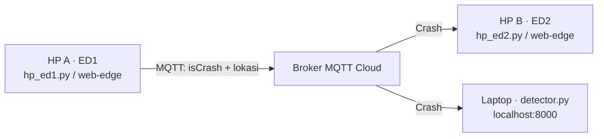

# CrashDetector IoT

Deteksi kecelakaan: **2 HP sebagai edge** (accelerometer, gyroscope, GPS), **MQTT broker HiveMQ Cloud**, dan **script + dashboard di laptop**. Alur menjalankannya sama seperti [contoh-project-iot1](https://github.com/myudak/contoh-project-iot1): `python detector.py` di laptop, lalu edge di HP lewat Termux atau browser.



## 0. Siapkan broker HiveMQ Cloud

1. Daftar gratis di [HiveMQ Cloud](https://www.hivemq.com/mqtt-cloud-broker/) dan buat cluster (Serverless).
2. Di **Access Management**, buat kredensial (username + password) dengan izin publish dan subscribe pada topic proyekmu.
3. Catat **alamat cluster** (`xxxx.s1.eu.hivemq.cloud`). Port yang dipakai: **8883** (MQTT + TLS, untuk Python/Termux) dan **8884** (WebSocket + TLS, untuk browser).

## 1. Laptop: jalankan detector & dashboard

Butuh **Python 3.10+** dan internet.

```bash
python -m pip install -r requirements.txt
cp .env.example .env          # Windows PowerShell: Copy-Item .env.example .env
python detector.py
```

Isi `.env`: `BROKER_HOST` (alamat cluster), `BROKER_USER`, `BROKER_PASS`, dan `PROJECT_ID` (nama kelompok yang unik). `.env` sudah ada di `.gitignore`, jangan di-commit. Buka **http://localhost:8000**. Setiap crash juga dicatat di `crash_log.csv`.

## 2. HP A (ED1) dan HP B (ED2): pilih salah satu

**Opsi A: Browser HP (tanpa Termux).** Publish folder `web-edge/` ke hosting HTTPS (Netlify Drop / GitHub Pages), buka di dua HP, pilih *Edge 1* di HP A dan *Edge 2* di HP B, isi alamat `wss://<cluster>.s1.eu.hivemq.cloud:8884/mqtt`, username, password, dan `PROJECT_ID` yang sama, tekan **Mulai**, lalu izinkan GPS dan sensor gerak.

**Opsi B: Termux + Python.** Ikuti [docs/ANDROID.md](docs/ANDROID.md), lalu:

```bash
python hp_ed1.py     # HP A: sensor + deteksi + kirim crash
python hp_ed2.py     # HP B: terima crash + notifikasi/getar/suara
```

Jalankan di dua HP fisik, bukan dua terminal laptop. Semua perangkat butuh internet.

## 3. Coba sistemnya

Di HP A tekan **Simulasi kecelakaan** (browser) atau ketik `s` + Enter (Termux). Dashboard berubah menjadi `KECELAKAAN TERDETEKSI` dan HP B berbunyi/bergetar. Untuk uji sambil berjalan, turunkan ambang di `.env` (mis. `SPEED_BEFORE_KPH=3`, `IMPACT_G=2`), jalan lalu berhenti mendadak sambil menggoyang HP. Jangan menguji dengan kendaraan sungguhan.

## Cara kerja deteksi (ED1)

| Sensor | Dipakai untuk |
|---|---|
| GPS | kecepatan (cadangan: jarak antar titik / waktu) dan lokasi |
| Accelerometer | benturan ≥ 3 g |
| Gyroscope | rotasi/terguling ≥ 250 °/s |

**Crash** bila dalam 5 detik kecepatan turun dari ≥ 30 km/jam ke ≤ 5 km/jam **dan** ada benturan atau rotasi keras dalam 4 detik terakhir (mencegah rem mendadak dianggap crash). Setelah crash ada jeda 30 detik.

Topic: `crashdetector/<PROJECT_ID>/crash` (QoS 1)

```json
{"isCrash": true, "deviceId": "ED1", "ts": "2026-10-29T08:00:00+00:00",
 "location": {"lat": -7.0051, "lon": 110.4381, "accuracy": 10},
 "speedBefore": 30, "speedAfter": 0, "gPeak": 4.2, "rotationPeak": 310, "simulated": false}
```

## Pelajari kodenya

- `detector.py` → NODE 3 (laptop + dashboard localhost)
- `hp_ed1.py` → NODE 1 (sensor HP A lewat Termux)
- `hp_ed2.py` → NODE 2 (penerima HP B lewat Termux)
- `web-edge/index.html` → alternatif NODE 1 / NODE 2 via browser
- `shared/detection.py` → fusi GPS + accelerometer + gyroscope
- `scripts/check_sensors.py`, `scripts/simulate_ed1.py` → debug; `tests/` → `python -m unittest`

> Proyek belajar, bukan sistem keselamatan sungguhan. Username/password hanya diketik di halaman browser (tidak tersimpan di file); jangan menaruhnya di kode yang dipublish. Untuk broker publik, kosongkan username/password dan pakai `broker.hivemq.com`, tetapi jangan kirim lokasi pribadi. Simulator tidak dihitung sebagai edge fisik.
